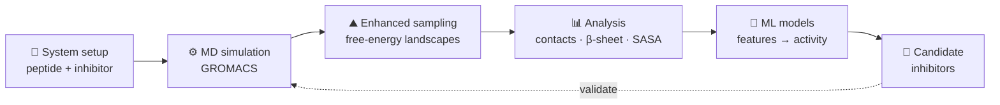

<!-- ═══════════════════════════════  HEADER  ═══════════════════════════════ -->

  
  
  

<!-- ═══════════════════════════════  ABOUT  ═══════════════════════════════ -->

## 🧬 About Me

<table>
<tr>
<td width="58%" valign="top">

I'm a PhD researcher in **computational (bio)physical chemistry**. I use **all-atom molecular dynamics**
to understand how aromatic amino acids, short peptides and proteins self-assemble into amyloid-like
aggregates, and how **natural small molecules** can interrupt that process.

On the other side of my work, I build **ML/AI workflows** that turn simulation data into predictions,
so better aggregation inhibitors can be found faster than by simulation alone.

</td>
<td width="42%" valign="top">

**🔭 Currently**
- Simulating peptide aggregation & inhibitor binding
- Enhanced-sampling free-energy studies
- ML models for inhibitor screening

**🌱 Exploring**
- Quantum computing for chemistry
- Generative models for molecules

</td>
</tr>
</table>

<!-- ═══════════════════════════════  RESEARCH  ═══════════════════════════════ -->

## 🔬 Research Themes

<table>
<tr>
<td width="33%" valign="top" align="center">
<h3>🧫</h3>
<b>Aggregation Mechanisms</b> 
Self-assembly of aromatic amino acids, peptides and proteins: nucleation, β-sheet formation and fibril stability
</td>
<td width="33%" valign="top" align="center">
<h3>💊</h3>
<b>Small-Molecule Inhibition</b> 
Binding modes, interaction energetics and mechanisms of natural inhibitors that disrupt aggregation
</td>
<td width="33%" valign="top" align="center">
<h3>🤖</h3>
<b>ML-Guided Discovery</b> 
Simulation-derived features and machine learning to screen and rank better inhibitor candidates
</td>
</tr>
</table>

### Workflow

<!-- ═══════════════════════════════  PUBLICATIONS  ═══════════════════════════════ -->

## 📄 Publications

<!-- Replace with your papers (newest first). Remove this section until you have one. -->
- **Paper title goes here** — Author A, **A. A. Mandal**, Author C · *Journal Name* (2026) · [DOI](https://doi.org/xx.xxxx/xxxxx)
- **Paper title goes here** — **A. A. Mandal**, Author B · *Journal Name* (2025) · [DOI](https://doi.org/xx.xxxx/xxxxx)

<!-- ═══════════════════════════════  PROJECTS  ═══════════════════════════════ -->

## 🚀 Featured Projects

<!-- Replace repo-name / descriptions with your best 2–4 repositories -->
| Project | What it does | Tech |
| :-- | :-- | :-- |
| **[repo-name](https://github.com/azizsimx/repo-name)** | One-line description of the project | `GROMACS` `Python` |
| **[repo-name](https://github.com/azizsimx/repo-name)** | One-line description of the project | `PyTorch` `RDKit` |
| **[azizsimx.github.io](https://azizsimx.github.io/)** | Personal website: research, notes and updates | `HTML` `CSS` |

<!-- ═══════════════════════════════  TOOLS  ═══════════════════════════════ -->

## 🛠️ Toolbox

<table>
<tr>
<td width="25%" valign="top"><b>⚙️ Simulation</b></td>
<td>

</td>
</tr>
<tr>
<td valign="top"><b>🔍 Analysis & Visualization</b></td>
<td>

</td>
</tr>
<tr>
<td valign="top"><b>🤖 ML & Cheminformatics</b></td>
<td>

</td>
</tr>
<tr>
<td valign="top"><b>💻 Languages & Workflow</b></td>
<td>

</td>
</tr>
</table>

<!-- ═══════════════════════════════  CONNECT  ═══════════════════════════════ -->

## 🤝 Connect

<i>Open to collaborations on molecular simulation, protein/peptide aggregation, small-molecule inhibitor design and ML for drug discovery.</i>

<!-- ═══════════════════════════════  FOOTER  ═══════════════════════════════ -->

