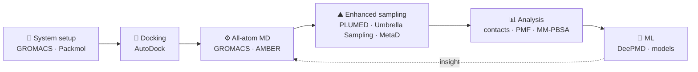

<!-- ═══════════════════════════════  HEADER  ═══════════════════════════════ -->

  
  
  
  

<!-- ═══════════════════════════════  ABOUT  ═══════════════════════════════ -->

## 🧬 About Me

<table>
<tr>
<td width="58%" valign="top">

I'm a **Research Scholar (PhD)** in Computational (Bio)Physical Chemistry at the
**S. N. Bose National Centre for Basic Sciences (SNBNCBS)**, Kolkata.

My research uses **atomistic molecular dynamics** and **statistical mechanics** to understand
molecular aggregation pathways in disease-linked peptide and protein systems, and how
**small organic molecules** and **metal ions** modulate them. I'm expanding toward
**machine-learning potentials** and **enhanced sampling** to reach timescales beyond conventional MD.

</td>
<td width="42%" valign="top">

**🔭 Currently**
- Inhibition of amyloid self-assembly by small molecules
- Free-energy landscapes with Umbrella Sampling & Metadynamics
- ML potentials (DeePMD) for biomolecular systems

**🎓 Education**
- PhD, SNBNCBS / Jadavpur University · 2023–
- M.Sc. Chemistry, University of Calcutta · 2022
- B.Sc. Chemistry (Hons.), Maulana Azad College · 2020

</td>
</tr>
</table>

<!-- ═══════════════════════════════  RESEARCH  ═══════════════════════════════ -->

## 🔬 Research Themes

<table>
<tr>
<td width="33%" valign="top" align="center">
<h3>🧫</h3>
<b>Amyloid Aggregation & Inhibition</b> 
Aggregation pathways of disease-linked peptides and proteins, and their modulation by small molecules and metal ions
</td>
<td width="33%" valign="top" align="center">
<h3>⛰️</h3>
<b>Enhanced Sampling & Free Energy</b> 
Metadynamics, replica exchange, umbrella sampling and MBAR for free-energy landscapes
</td>
<td width="33%" valign="top" align="center">
<h3>🤖</h3>
<b>Machine Learning</b> 
ML-based molecular potentials and data-driven approaches for complex biological systems
</td>
</tr>
<tr>
<td width="33%" valign="top" align="center">
<h3>💧</h3>
<b>Solvation & Hydration</b> 
How water structure and dynamics shape stability, aggregation and molecular recognition
</td>
<td width="33%" valign="top" align="center">
<h3>💊</h3>
<b>Protein–Ligand Interactions</b> 
Docking, MD and free-energy analysis of inhibitors binding to aggregation-prone biomolecules
</td>
<td width="33%" valign="top" align="center">
<h3>🌀</h3>
<b>Intrinsically Disordered Proteins</b> 
Conformational ensembles, intermolecular contacts and aggregation propensity of IDPs
</td>
</tr>
</table>

### Workflow

<!-- ═══════════════════════════════  PUBLICATIONS  ═══════════════════════════════ -->

## 📄 Publications

> **Mechanistic Role of Different Functional Groups in Inhibiting Tryptophan Self-Assembly: Comparison between Aromatic and Nonaromatic Hydroxyl Moiety-Rich Chemical Compounds** 
> **Abdul Aziz Mandal**, Sudipta Mitra, Suman Chakrabarty, Ranjit Biswas\* 
> *The Journal of Physical Chemistry B* **2026**, 130 (35), 8794–8804 
> 
### 🎤 Talks & Posters

| Date | Event | Type |
| :-- | :-- | :-- |
| Oct 2026 | Frontiers of Physical Chemistry (FPC 2026), SNBNCBS · [poster](https://azizsimx.github.io/AAM_FPC2026.pdf) | Poster |
| Sep 2026 | Frontier Research in Basic Sciences & Development of Advanced Technologies in India, IEM Gurukul · [poster](https://azizsimx.github.io/AAM_A0_Bengali_TRP_Poster.pdf) | Poster · 🏆 **Best Poster Award** |
| Mar 2026 | BOSE FEST 2026, SNBNCBS: *Tannic acid-mediated inhibition of tryptophan amyloid aggregation* | Oral |

### 🏅 Honours

- 🏆 **Best Poster Award** — Frontier Research in Basic Sciences, IEM Gurukul Campus (2026)
- 🎓 **INSPIRE Fellowship (JRF)** — for doctoral research at SNBNCBS (2023)
- ⭐ **INSPIRE Scholarship** — top 1% in the Higher Secondary Examination, West Bengal (2017)

<!-- ═══════════════════════════════  PROJECTS  ═══════════════════════════════ -->

## 🚀 Software I Built

| App | What it does | Try it |
| :-- | :-- | :-- |
| **VAMD** | Visual Analysis of Molecular Dynamics: a lightweight browser-based structure & trajectory viewer | [Open ↗](https://azizsimx.github.io/vamd.html) |
| **Figure Palette Lab** | Accessible, publication-ready colour palettes for scientific figures | [Open ↗](https://azizsimx.github.io/Palette_Lab.html) |
| **VIBGYOR Color Studio** | Explore, create and manage colour schemes in the browser | [Open ↗](https://azizsimx.github.io/VIBGYOR.html) |
| **[azizsimx.github.io](https://azizsimx.github.io/)** | My research website: publications, tools and curated MD tutorials | [Visit ↗](https://azizsimx.github.io/) |

<!-- ═══════════════════════════════  TECH STACK  ═══════════════════════════════ -->

## 🛠️ Tech Stack

  
  
  
  
  
  
  
   
  
  
  
  
  
  
   
  
  
  
  
  
  
  
  
  

---

<!-- ═══════════════════════════════  GITHUB STATS  ═══════════════════════════════ -->
<!-- These read your PUBLIC activity: your profile must not be set to private -->

---

<!-- ═══════════════════════════════  REPOSITORIES  ═══════════════════════════════ -->

## 📦 Open-Source Repositories

| Repository | What's inside | Language |
| :-- | :-- | :-- |
| **[Simulation_Methods](https://github.com/azizsimx/Simulation_Methods)** | Advanced numerical methods and simulations | `Jupyter Notebook` |
| **[IDP_pdb](https://github.com/azizsimx/IDP_pdb)** | Structures and notebooks for intrinsically disordered proteins | `Jupyter Notebook` |
| **[Quantum-Computing-Qiskit](https://github.com/azizsimx/Quantum-Computing-Qiskit)** | M.Sc. project: *Quantum Cryptography — An IBMQ Experience* | `Qiskit` `Python` |
| **[Python_Tutorial](https://github.com/azizsimx/Python_Tutorial)** | Python from scratch to advanced, for students starting out | `Jupyter Notebook` |

---

<!-- ═══════════════════════════════  CONNECT  ═══════════════════════════════ -->

## 🤝 Connect

<i>Open to research collaborations and discussions on computational biophysical chemistry, amyloid aggregation, enhanced sampling and ML for molecular systems.</i>

 

📍 Department of Chemical & Biological Sciences, S. N. Bose National Centre for Basic Sciences, Kolkata, India

<!-- ═══════════════════════════════  SNAKE  ═══════════════════════════════ -->
<!-- Drawn by .github/workflows/snake.yml into the "output" branch -->

<picture>
  <source media="(prefers-color-scheme: dark)" srcset="https://raw.githubusercontent.com/azizsimx/azizsimx/output/github-snake-dark.svg" />
  <source media="(prefers-color-scheme: light)" srcset="https://raw.githubusercontent.com/azizsimx/azizsimx/output/github-snake.svg" />
  
</picture>

<!-- ═══════════════════════════════  FOOTER  ═══════════════════════════════ -->

